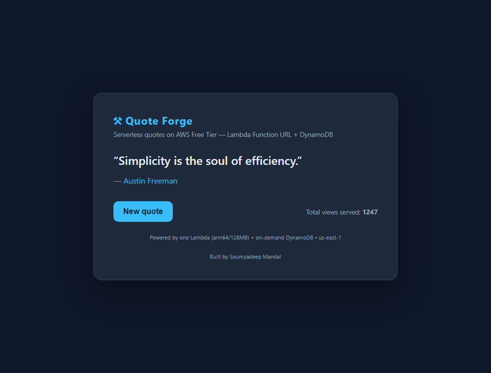

# Quote Forge

A tiny serverless web app on the **AWS Free Tier**: one Lambda function (arm64,
128 MB) sitting behind a **Lambda Function URL** serves both an HTML page and a
JSON quote endpoint, and keeps a running **view counter** in an on-demand
DynamoDB table. No API Gateway, no S3, no CloudFront — the smallest footprint
that still does something real.



## Architecture

```
                 ┌──────────────────────────────┐
   Browser  ───▶ │  Lambda Function URL (NONE)   │
   GET /         │  AuthType = NONE, public      │
   GET /api      └───────────────┬──────────────┘
                                 │
                      ┌──────────▼───────────┐
                      │  Lambda: quote-forge  │   arm64 · 128 MB · py3.12
                      │  - "/"   -> HTML page │   7-day log retention
                      │  - "/api"-> JSON quote│
                      └──────────┬───────────┘
                                 │ UpdateItem (ADD count :1)
                      ┌──────────▼───────────┐
                      │ DynamoDB: quote-forge │   PAY_PER_REQUEST
                      │ -stats (pk = "views") │   (on-demand)
                      └──────────────────────┘
```

## AWS services used

| Service          | Why                                              | Cost on Free Tier |
|------------------|--------------------------------------------------|-------------------|
| AWS Lambda       | Runs the app; serves HTML + JSON                 | 1M req/mo free    |
| Lambda Function URL | Public HTTPS endpoint without API Gateway     | Free              |
| Amazon DynamoDB  | On-demand view counter                           | 25 GB + 25 WCU/RCU free |
| Amazon CloudWatch Logs | Function logs, 7-day retention             | 5 GB/mo free      |

Everything is defined in a single CloudFormation template: `template.yaml`.

## Deploy

Credentials and region must be configured first (`aws configure`,
region `us-east-1`).

```bash
aws cloudformation deploy \
  --template-file template.yaml \
  --stack-name quote-forge \
  --capabilities CAPABILITY_NAMED_IAM \
  --region us-east-1
```

Get the public URL from the stack outputs:

```bash
aws cloudformation describe-stacks \
  --stack-name quote-forge \
  --region us-east-1 \
  --query "Stacks[0].Outputs[?OutputKey=='SiteUrl'].OutputValue" \
  --output text
```

Open that URL in a browser (HTML page) or append `/api` for the JSON endpoint.

## Validate (optional, before deploy)

```bash
aws cloudformation validate-template \
  --template-body file://template.yaml \
  --region us-east-1
```

## Tear down

Deleting the stack removes the Lambda, Function URL, IAM role, DynamoDB table
and log group — nothing is left behind.

```bash
aws cloudformation delete-stack --stack-name quote-forge --region us-east-1
aws cloudformation wait stack-delete-complete --stack-name quote-forge --region us-east-1
```

## Files

```
.
├── template.yaml          CloudFormation stack (all resources + inline Lambda code)
├── screenshots/           Screenshots of the running app
├── README.md
└── .gitignore
```
